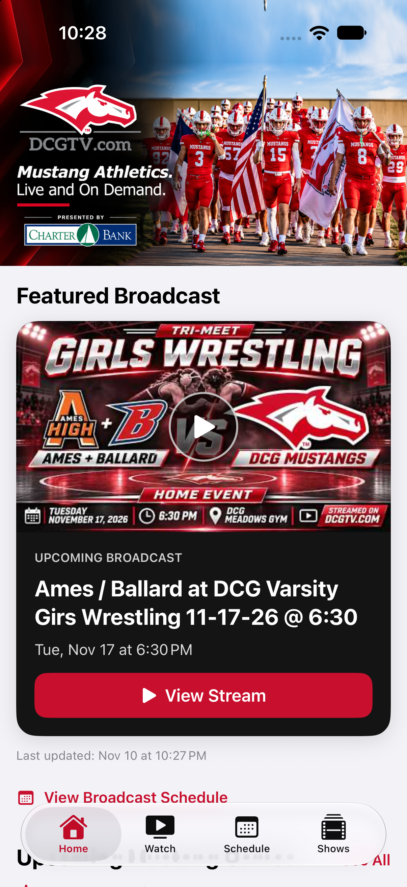
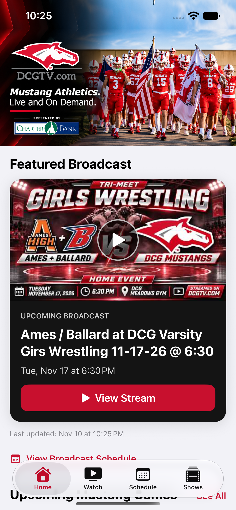
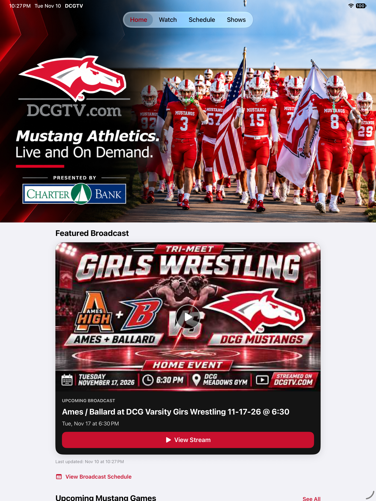
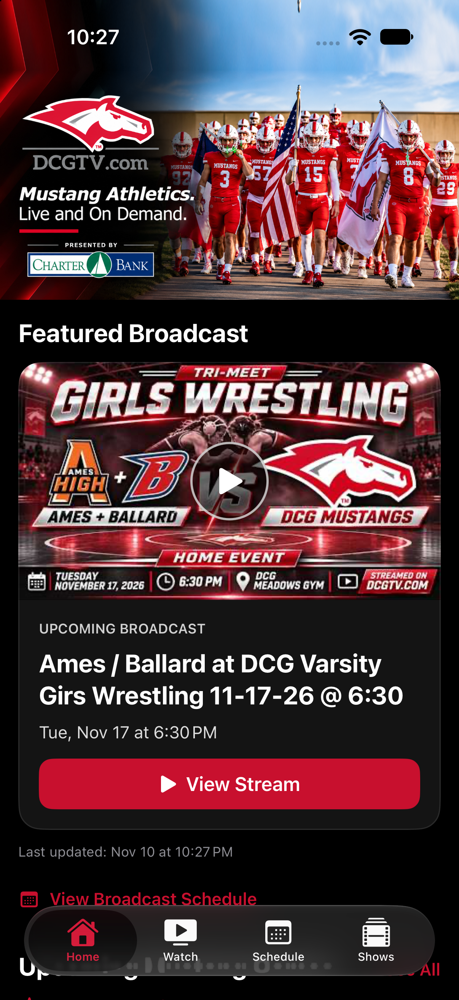
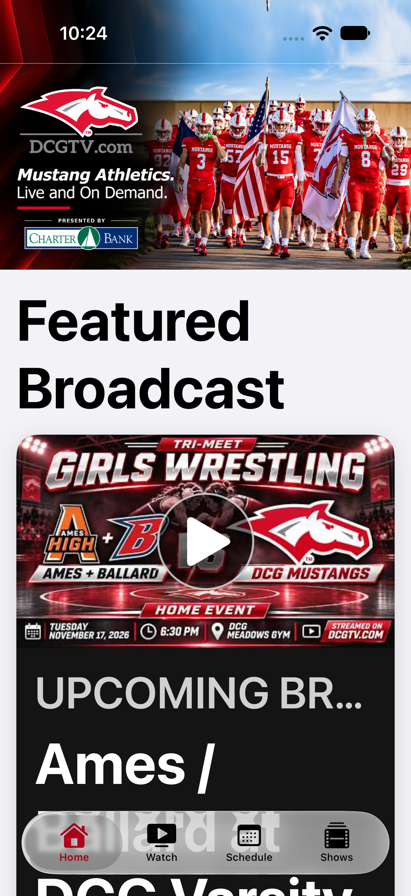

# Home hero edge-to-edge review

Based on main `29c8a24`, which includes Phase 1 #17 and the approved sponsored artwork #19. The alternate photo hero #18 is closed and unmerged. Phase 2 #20 remains separate. This branch changes Home layout and its UI checks only; services, artwork bytes, Watch sponsor placement, and Schedule behavior are preserved.

## Layout choice

The hero is outside Home's 16-point content padding and 760-point content-width limit. Its scroll view extends through the top and horizontal safe areas, while the content below keeps its readable width and horizontal safe-area protection. The original 1774 × 887 banner uses aspect fit at the full available display/window width, with no rounded mask, border, or crop. Its full DCGTV and Charter Bank logo/text remains visible in the image.

The complete banner begins below the measured top system inset. A vertically mirrored and stretched copy of the decorative top 8% fills the area behind the status bar and iPad's native top tabs. Mirroring joins the original top row without a blank strip or a hard restart of the diagonal artwork. A one-point overlap avoids a subpixel seam. Only this decorative extension is clipped; the complete banner is not clipped. The original asset is unchanged (SHA-256 `2459e2eae86a53f37ffff39a815440da0aae5b2a9f0f1da94e9b3546c5289ae7`). This is a rendered extension, not newly generated artwork.

The iOS 26+ top scroll-edge blur is disabled for Home only, with an availability guard for the app's older supported iOS versions. Bottom tab behavior is retained. VoiceOver receives one banner label including the sponsor acknowledgment; the decorative copy is hidden from accessibility.

## Tradeoffs and limits

- Aspect fill into a taller fixed hero would cut off parts of this text-heavy 2:1 design. Keeping the full image makes the banner height proportional to screen width, so the embedded small lettering is still small on narrow phones and does not grow with Dynamic Type. The accessibility label supplies its wording.
- The area behind the status bar is a mirrored decorative extension rather than the unmodified top of the image. Important artwork is kept below system chrome at the top of Home. Scrolling normally moves the banner beneath system chrome.
- In landscape, the full-width 2:1 banner can be taller than the viewport; scrolling reveals its lower part. A physical sensor housing may mask a few peripheral pixels. Simulator screenshots do not reproduce the physical notch or Dynamic Island mask. Physical-device checks remain appropriate before release.
- iPad fills its window width and keeps native top tabs. iPad multitasking/window resizing follows the available geometry; split view and Stage Manager were not manually exercised.
- No playback, network, backend, App Store, or navigation redesign is included.

## Phase 2 coexistence

A local trial merge with Phase 2 head `f4114068ff5a32cbc45dda4a763b8d0057d49916` completed without conflicts after isolating the new rotation/dark-mode tests in `DCGHomeHeroLayoutTests.swift`. Neither main nor the Phase 2 branch was modified. Future edits to either branch may require another compatibility check.

## Validation

Xcode 27.2 simulator build passed with the final source. Swift parsing and `git diff --check` passed. The 12 existing broadcast-service unit tests passed on iPhone 18 Pro (iOS 27.0). Four UI checks passed on each of iPhone 18 Pro (iOS 27.0), smaller iPhone 17e (iOS 27.0), and iPad Pro 13-inch M5 (iOS 27.2): edge/proportion checks plus sponsor/navigation regression, accessibility XXXL text, landscape/return-to-Home, and a dark-appearance launch override. After the final one-point seam refinement, the final iPad suite and iPhone build/screenshot review were repeated; the iPhone edge/navigation check was also repeated.

The edge check compares the real scroll viewport with screen y=0 on iPhone and the original banner with both horizontal display edges, at one-point tolerance. It also checks the original 2:1 proportions and absence of a duplicate Home sponsor. Watch's acknowledgment and Schedule navigation remain covered. A local trial merge with the unchanged Phase 2 head passed without conflicts.

Portrait screenshots below were visually inspected. Actual simulator dark appearance was separately enabled and visually checked; the automated launch-argument override alone did not reliably change simulator appearance. The simulator was restored to light appearance afterward. Landscape frame assertions pass, but exported landscape captures contain rotated/black regions in this simulator setup; landscape visual/notch review remains release QA. Several initial simulator sessions failed to start or were interrupted, and an initial transformed-container accessibility-frame assertion was replaced with the actual scroll viewport. The final individual device checks passed. No physical-device run was performed.

| iPhone | Smaller iPhone |
| --- | --- |
|  |  |

| iPad | Actual dark appearance | Accessibility XXXL |
| --- | --- | --- |
|  |  |  |
