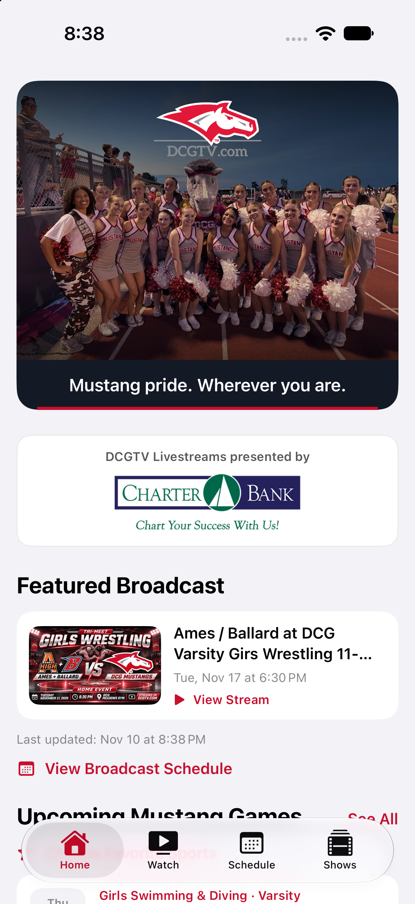
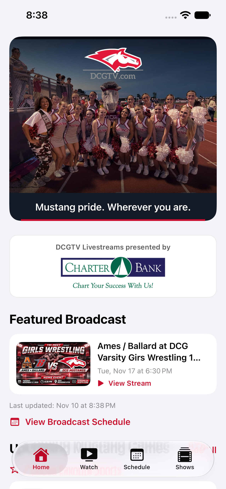
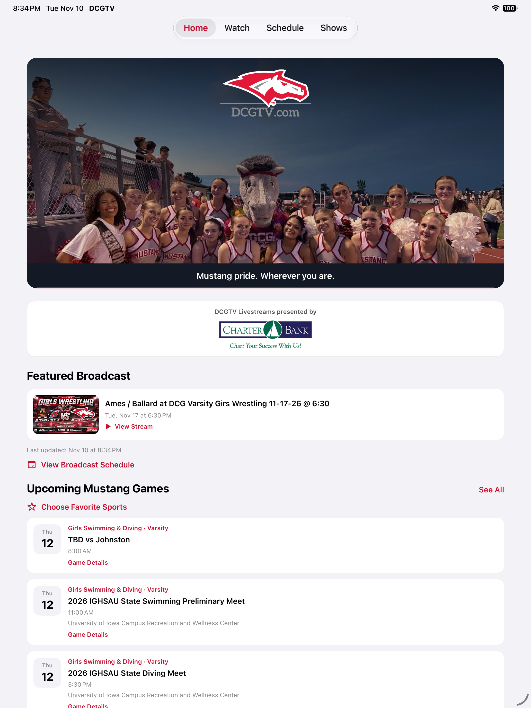
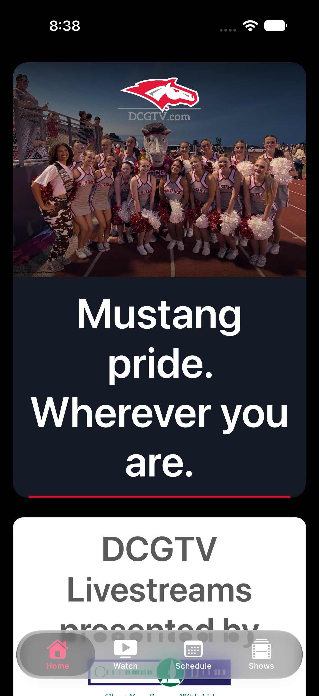

# DCGTV hero/header review

The Home header now uses the user's original `IMG_3188.png` with the existing `DCGTVLogo` asset, a dark sky gradient, and “Mustang pride. Wherever you are.” The group fits horizontally at every width; wider iPads crop the lower foreground rather than outer faces. The tagline sits in a flexible dark band below the photograph so accessibility text never covers faces. Home content is centered with a 960-point maximum width.

## Asset provenance

`MustangPrideHero.imageset/IMG_3188.png` is byte-for-byte identical to the uploaded photograph, SHA-256 `611d1964605507a1b6c673b7d2c51bd9cd8494d7ab8d2a0dd3503f7b8dd31209` (1206 × 894, approximately 1.8 MB). No people or logos were generated or replaced. The source conversation export provided the original photo and approved composition notes, but did not include the generated concept image; implementation follows those notes rather than claiming pixel matching to an unavailable mockup.

## Validation

- Xcode 27.2 simulator build succeeded (iOS 17.0 app deployment target unchanged).
- All 12 existing `DCG Booster ClubTests` passed on iPhone 18 Pro / iOS 27.0, including stale cache, offline failure, expiry, retry and cancellation live-status checks. Final logo spacing adjustment was rebuilt successfully.
- Visually inspected iPhone 18 Pro / iOS 27.2, smaller iPhone 17e / iOS 27.0, and iPad Pro 13-inch / iOS 27.2 in portrait.
- Inspected largest accessibility text (`accessibility-extra-extra-extra-large`) and dark mode on iPhone. Tagline wraps without clipping or overlapping faces. Header is one VoiceOver heading; decorative photo/logo do not repeat.
- Screenshots use the normal app and actual API responses, without seeded or mocked broadcasts. At capture, the featured event was upcoming girls wrestling on November 17, with “View Stream” and no LIVE badge.
- Original Charter Bank banner/link, API services, stream card/status logic, schedule, tab navigation, favorites and playback paths remain unchanged.
- No added network request, animation, image processing, or dependency; one bundled photo and SwiftUI gradients.
- `git diff --check` passed. Physical device, landscape, iPad split-view and VoiceOver listening checks remain release QA; no App Store build was uploaded.

## Screenshots

### iPhone

### Smaller iPhone

### iPad

### Largest text and dark mode

