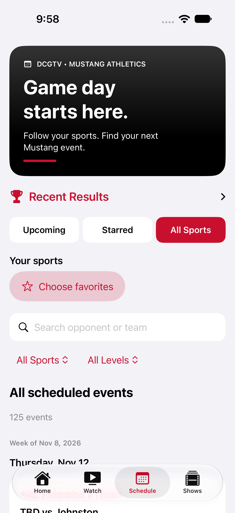
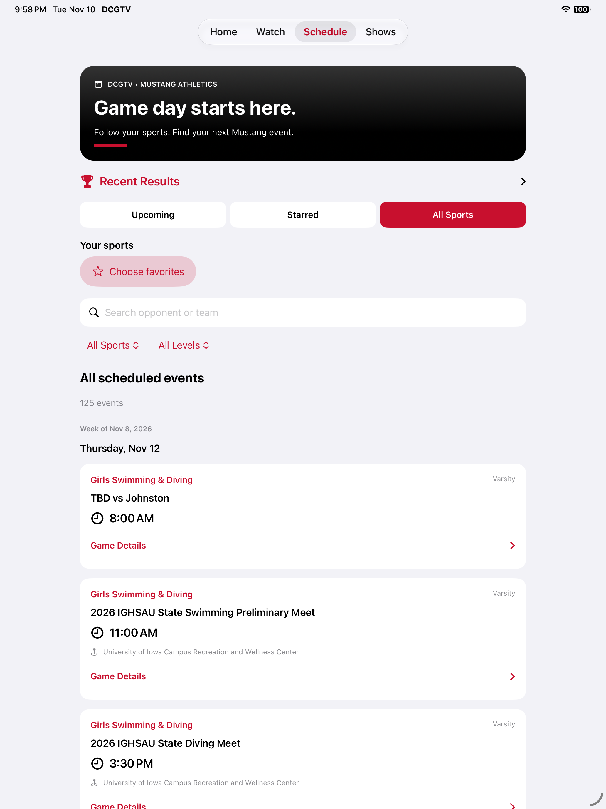
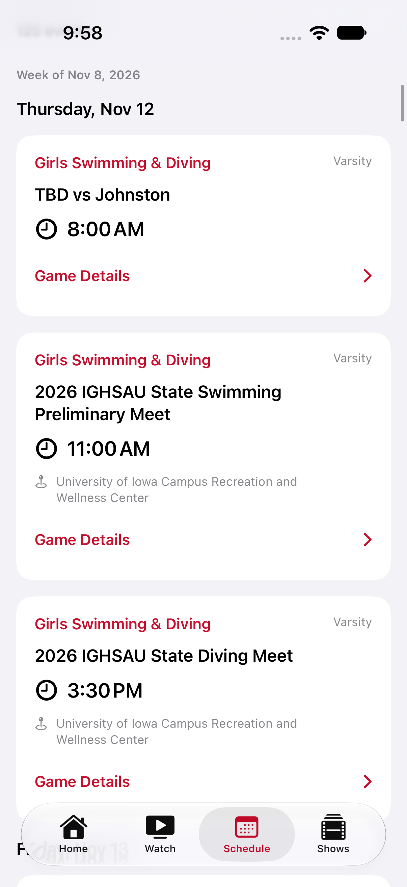
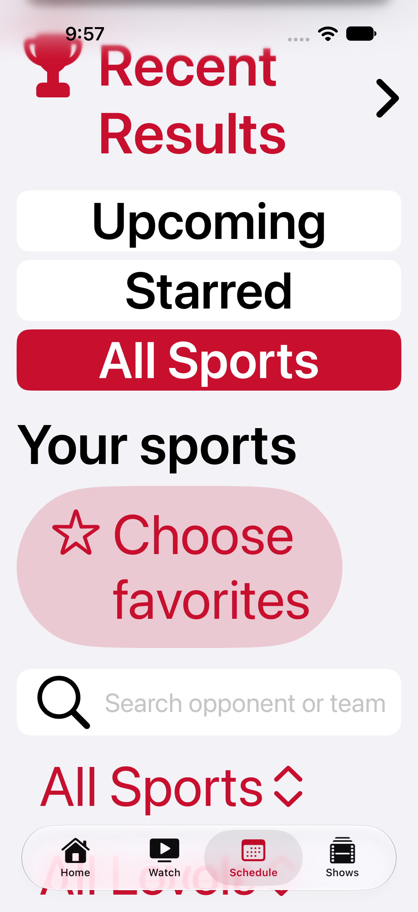
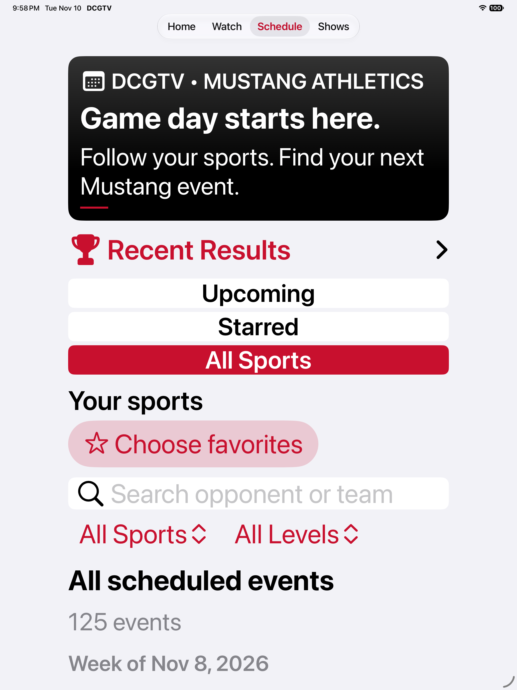

# Phase 2 — Schedule refresh

Built from main at `29c8a243`, including merged Phase 1 PR #17 and the approved sponsored hero in PR #19. The closed, unmerged alternate photo hero in PR #18 is untouched. Home artwork and sponsor placement are unchanged.

## Behavior

- A black DCGTV header with white typography and DCG red accents leads the Schedule tab. The existing Recent Results disclosure stays near the top.
- Upcoming shows today and future events, including earlier times today because the feed does not reliably describe event completion. Starred applies the same date rule to favorite sports. All Sports includes every event returned by the schedule feed and clears a specific sport selection; level and search remain visible, independent filters.
- Favorite chips filter by sport. Choose/Edit favorites reuses the existing picker and `dcgtv.favoriteSports` preference shared with Home. There is no new account or storage migration. Favorite chips become wrapping vertical buttons at accessibility text sizes.
- Search, sport, level, clear filters, refresh, retry, week/day grouping, event counts and undated-event fallback all use actual schedule data. Week boundaries follow the user's calendar; dates/times follow their locale and time zone. No date carousel or controls requiring unavailable data were added.
- Cards emphasize sport, matchup, time, venue and details. Existing conservative broadcast matching, HTTPS DCGTV links, third-party links/disclosures, event detail sheets, Bound/YouTube destinations, verified results and service/cache behavior remain intact.
- Content has a centered 760-point maximum width on iPad, with flexible vertical sizing, system text styles, adaptive selection/filter layouts, 44-point primary controls, selected accessibility traits, named actions and heading traits.

## Validation

Xcode 27.2 simulator build succeeded. All 14 unit tests (12 existing service tests and 2 new filter tests), plus 3 UI tests passed on both iPhone 18 Pro and iPad Pro 13-inch (M5), iOS 27.2: 34 successful test runs with no failures or runtime warnings in the result summary. The UI tests cover the merged Home hero/sponsor/navigation behavior, Schedule selections and favorite-picker access, event details, and accessibility XXXL text. Swift syntax parsing and `git diff --check` also passed. Screenshots below were exported from the final test result and visually reviewed. UI tests use the real feed; the event-detail navigation check requires at least one returned schedule event. Unit tests use local fixtures only for filter semantics and do not add sample events to the app.

## Remaining review

The earlier reference screenshot was not present in the available conversation export, so this follows the requested palette and merged Phase 1 design language rather than claiming a pixel match. VoiceOver labels/traits were reviewed and accessibility text sizes exercised; a physical-device VoiceOver listening pass, real playback/external destination checks, iPad split view and landscape remain release QA. Results continue to come only from the existing verified-results service; no scores or results were invented. Per-event starring and a date carousel are deferred; Starred uses the existing sport preferences.

## Screenshots

| iPhone | iPad |
| --- | --- |
|  |  |
|  |  |
|  |  |
